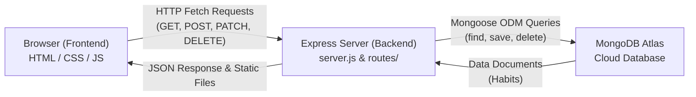

# 🌱 Habit Garden

A calm, simple, full-stack habit tracking web application designed to help you nurture positive daily routines. Built using vanilla JavaScript, Node.js, Express, and MongoDB Atlas with Mongoose.

---

## 🔗 Live Demo
* **Live Demo:** `[Live Demo Placeholder - e.g. https://habit-garden.onrender.com]` *(Add your deployed URL here)*

---

## ✨ Features

- **Daily Focus:** Displays "Habit Garden" along with today's dynamically formatted date.
- **Add Habits:** Create new daily habits with immediate validation.
- **Persistent Habit List:** Fetches and displays all habits directly from MongoDB Atlas.
- **Daily Checkbox Toggle:** Mark habits as completed or not completed specifically for today.
- **Progress Tracking:** Real-time progress bar and display showing completed tasks (e.g., *"2 of 4 done (50%)"*) with encouraging quotes.
- **Delete Habits:** Cleanly remove habits from your garden with confirmation safeguards.
- **Data Persistence:** Your habit history and completion dates persist securely across page refreshes and browser restarts.
- **Soothing & Responsive Aesthetic:** Garden-inspired sage green, cream, and white palette optimized for both desktop/laptop and mobile screens.

---

## 🛠️ Tech Stack

- **Frontend:**
  - Semantic HTML5
  - Modern, responsive CSS3 (CSS Custom Properties / Variables, Flexbox, accessible form styling)
  - Vanilla JavaScript (ES6+, `fetch` API, dynamic DOM manipulation — no external UI frameworks)
- **Backend:**
  - [Node.js](https://nodejs.org/) runtime
  - [Express.js](https://expressjs.com/) web server and REST API
- **Database & ODM:**
  - [MongoDB Atlas](https://www.mongodb.com/atlas) cloud database
  - [Mongoose](https://mongoosejs.com/) for data modeling, schemas, and queries
- **Configuration:**
  - [dotenv](https://www.npmjs.com/package/dotenv) for environment variable isolation

---

## 📂 Project Structure

```text
habit-tracker/
├── .env.example        # Template for environment variables (copy to .env)
├── .gitignore           # Prevents committing node_modules and real .env
├── package.json         # Project metadata, scripts, and dependencies
├── server.js            # Express server setup, database connection & static file serving
├── README.md            # Documentation and setup instructions
├── models/
│   └── Habit.js         # Mongoose schema and model for habits
├── routes/
│   └── habits.js        # REST API route handlers (GET, POST, DELETE, PATCH)
└── public/              # Static frontend client files
    ├── index.html       # Single-page HTML interface
    ├── style.css        # Sage-green styling and responsive layout
    └── script.js        # Vanilla JS client logic and API integration
```

---

## 🚀 Getting Started & Setup

Follow these simple steps to run Habit Garden locally on your machine.

### 1. Prerequisites
Ensure you have the following installed:
- **Node.js** (v18.0.0 or higher recommended): [Download Node.js](https://nodejs.org/)
- **npm** (comes bundled with Node.js)
- A free **MongoDB Atlas** account: [Sign up for MongoDB Atlas](https://www.mongodb.com/cloud/atlas/register)

---

### 2. Install Dependencies
Open your terminal or command prompt in the project root directory and run:

```bash
npm install
```

This installs `express`, `mongoose`, and `dotenv`.

---

### 3. Set Up Your MongoDB Atlas Database

1. Log into your [MongoDB Atlas](https://cloud.mongodb.com/) dashboard.
2. Create a free shared cluster (M0 sandbox).
3. Under **Database Access**, create a database user with a username and password (remember these credentials).
4. Under **Network Access**, click **Add IP Address** and choose **Allow Access From Anywhere (`0.0.0.0/0`)** or your current IP address.
5. In your cluster view, click **Connect** → **Drivers** (Node.js).
6. Copy your connection string URI. It looks similar to:
   ```text
   mongodb+srv://<username>:<password>@cluster0.abcde.mongodb.net/habitgarden?retryWrites=true&w=majority
   ```

---

### 4. Configure Environment Variables

1. In the root directory, create a new file named `.env` by copying `.env.example`:
   - On Windows (PowerShell):
     ```powershell
     Copy-Item .env.example .env
     ```
   - On Mac/Linux:
     ```bash
     cp .env.example .env
     ```
2. Open `.env` and paste your actual MongoDB Atlas connection URI:
   ```env
   PORT=3000
   MONGODB_URI=mongodb+srv://<username>:<password>@cluster0.abcde.mongodb.net/habitgarden?retryWrites=true&w=majority
   ```
   *(Replace `<username>` and `<password>` with your database user credentials)*.

---

### 5. Run the Application

Start the server using npm:

```bash
npm start
```

Or run with automatic reload during development (Node 18+):

```bash
npm run dev
```

You should see:
```text
🌿 Habit Garden is blooming at http://localhost:3000
🌱 Connected successfully to MongoDB Atlas.
```

Open your browser and navigate to:
```text
http://localhost:3000
```

---

## 📡 API Reference

All habit endpoints are prefixed with `/api/habits`:

| Method | Endpoint | Description | Request Body | Response Status |
| :--- | :--- | :--- | :--- | :--- |
| **GET** | `/api/habits` | Retrieves all habits sorted newest first | None | `200 OK` |
| **POST** | `/api/habits` | Creates a new habit | `{ "name": "Read 15 mins" }` | `201 Created` |
| **DELETE** | `/api/habits/:id` | Deletes a habit by its MongoDB `_id` | None | `200 OK` |
| **PATCH** | `/api/habits/:id/toggle` | Toggles completion for a given date | `{ "date": "2026-10-23" }` | `200 OK` |

---

## 🧠 How the Frontend, Backend & Database Connect

Understanding full-stack architecture as a beginner:



1. **The Client (Frontend):** When you open `http://localhost:3000`, the browser requests `index.html`, `style.css`, and `script.js`. `script.js` calls `fetch('/api/habits')` to request data from the server.
2. **The Server (Backend):** `server.js` listens for incoming HTTP requests on port `3000`. Express forwards `/api/habits` requests to `routes/habits.js`.
3. **The Database (Mongoose & Atlas):** In `routes/habits.js`, Mongoose translates JavaScript actions into MongoDB queries using the blueprint defined in `models/Habit.js`. The database stores the documents permanently in the cloud.
4. **The Loop Closes:** Express sends the results back to `script.js` as JSON. `script.js` updates the HTML elements on your screen instantly.

---

## 🔮 Planned Features (Roadmap)

Future enhancements envisioned for Habit Garden:
- [ ] **User Authentication:** Sign up and log in so multiple users can have private gardens.
- [ ] **Streak Tracking:** Consecutive day counter and fire/sprout badges for unbroken daily habits.
- [ ] **Weekly & Monthly Calendar View:** A visual calendar grid showing completion history over time.
- [ ] **Habit Categories & Colors:** Tag habits by category (Health, Mind, Learning, Productivity) with custom botanical icons.
- [ ] **Archive Feature:** Pause habits without deleting their historical records.
- [ ] **Sound Effects & Confetti:** Gentle botanical chime sound and bloom effect when reaching 100% completion.

---

## 📄 License
This project is open source and available under the [MIT License](LICENSE).
